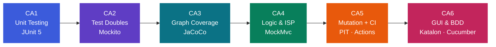
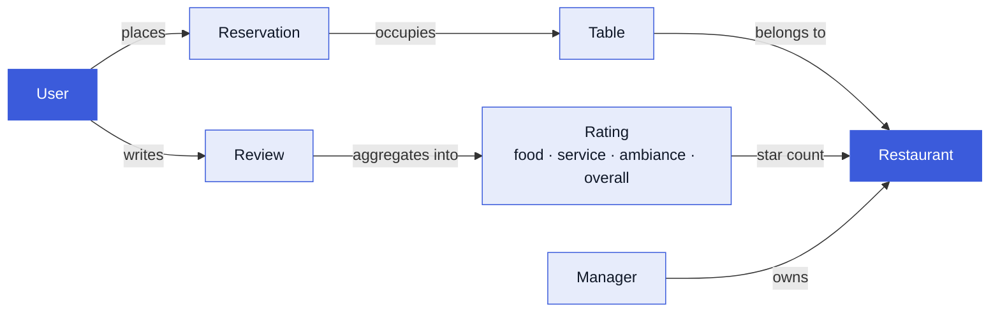
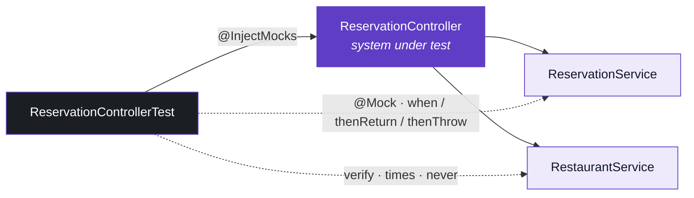
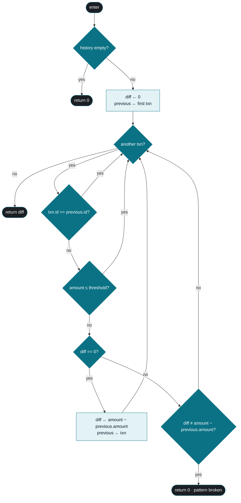
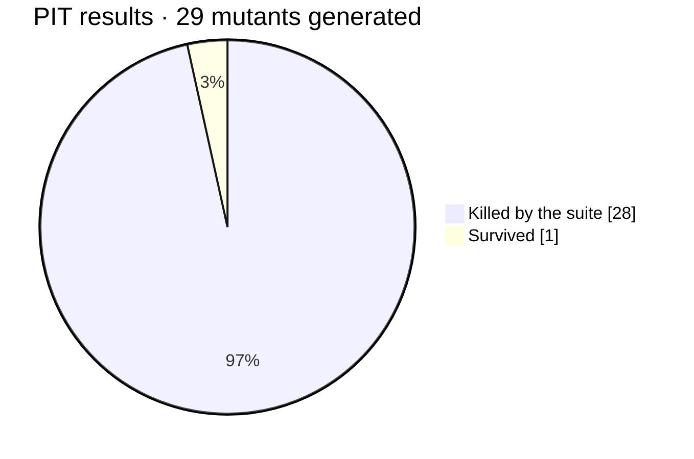
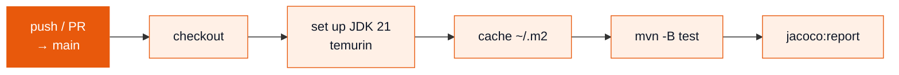
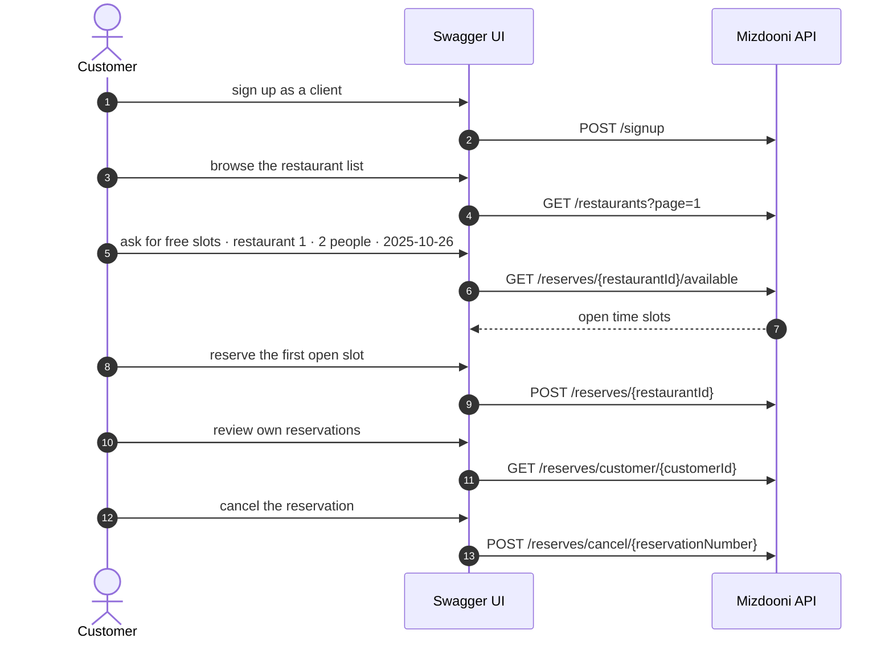
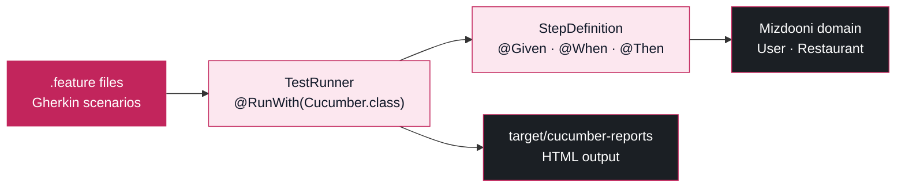

<div align="center">

# Software Testing · Course Projects

**University of Tehran — Software Testing (SWT), Fall 1403 / 2024**
Instructor: Dr. Ehsan Khamespanah

*Six assignments that walk one codebase from a first `assertEquals` all the way to
recorded browser scenarios — stopping at mocks, control-flow graphs, logic criteria,
mutants and a CI pipeline along the way.*

<br/>


</div>

---

## The arc

Each assignment adds one layer of testing theory on top of the last. Same systems, deeper questions.



| | Assignment | What is being tested | Core idea | Tooling | Tests |
|:--|:--|:--|:--|:--|--:|
|  | **[Unit Testing](CA1)** | Mizdooni domain model | isolated units, parameterized cases | JUnit 5 | 36 |
|  | **[Test Doubles](CA2)** | Mizdooni controllers | mock vs. stub, state vs. behavior verification | Mockito | 58 |
|  | **[Graph Coverage](CA3)** | Fesadyab fraud engine | CFG, statement & branch coverage | JaCoCo | 14 |
|  | **[Logic & ISP](CA4)** | Mizdooni HTTP API | CACC / RACC, input-space partitioning | MockMvc | 83 |
|  | **[Mutation & CI](CA5)** | Fesadyab fraud engine | mutants as a test of the tests | PIT + GitHub Actions | 14 |
|  | **[GUI & BDD](CA6)** | Mizdooni through the browser | record-and-replay, Given/When/Then | Katalon Recorder · Selenium · Cucumber | 83 <sub>+8 scenarios</sub> |

> Every assignment folder is a self-contained snapshot of the project at that point, so later
> folders carry the earlier suites forward — 288 test methods across the six snapshots.

---

## The two systems under test

<table>
<tr>
<td width="50%" valign="top">

### 🍽 Mizdooni
A Spring Boot restaurant-reservation service: users sign up, browse restaurants,
check which tables are free in a time window, reserve, review and cancel.
Rich domain invariants (working hours, manager permissions, duplicate reviews,
past datetimes) make it a generous target for tests.

**Used in** CA1 · CA2 · CA4 · CA6

</td>
<td width="50%" valign="top">

### 🕵️ Fesadyab
A compact bank-fraud detector: it keeps a transaction history, derives per-account
averages, hunts for arithmetic patterns above a threshold, and scores suspicious
debits. Tiny surface, dense branching — exactly what coverage and mutation
analysis want.

**Used in** CA3 · CA5

</td>
</tr>
</table>



---

<a id="ca1"></a>
##  Unit Testing · JUnit 5

> **The problem.** Mizdooni ships with no tests at all. Build the first safety net: unit tests for
> the logic-carrying methods of `User`, `Table`, `Restaurant` and `Rating` — one behaviour per test,
> no shared state between tests, and no wasted tests on bare getters, setters or constructors.


The interesting cases are the ones where the domain quietly bends the rules — a cancelled
reservation that must stop counting as reserved, a second review by the same user that should
*replace* rather than append, an empty restaurant whose average rating must not divide by zero.
`Rating.getStarCount()` is the natural parameterized target: a rounding rule with a hard ceiling
at five stars, swept across eight inputs instead of eight near-identical test methods.

```java
@ParameterizedTest
@CsvSource({
    "4.6, 5",   // rounds up, clamped at the maximum
    "2.5, 3",   // half rounds up
    "0.1, 0",   // rounds down to the floor
    "10.0, 5"   // out of range, still capped
})
public void testGetStarCount(double overall, int expectedStarCount) { ... }
```

**Where to look** → [`CA1/Mizdooni/src/test/java/mizdooni/model/`](CA1/Mizdooni/src/test/java/mizdooni/model) ·
theory answers in [`CA1/Theory-Questions.md`](CA1/Theory-Questions.md)

---

<a id="ca2"></a>
##  Test Doubles · Mockito

> **The problem.** Controllers cannot be unit-tested honestly while they reach into real services.
> Write genuine *unit* tests for `AuthenticationController`, `ReservationController` and
> `ReviewController` by replacing every collaborator with a test double — and fix the small bugs
> the tests expose along the way.


Mockito draws a hard border around the controller: everything inside is real code under test,
everything outside is a double that is either *trained* (`when(...).thenReturn(...)`) or
*interrogated* (`verify(...)`).



Each controller is pushed through both halves of its contract: the happy path (correct
`Response`, correct `HttpStatus`, service called exactly once with the expected arguments) and the
full catalogue of failures — `UserNotFound`, `ManagerReservationNotAllowed`,
`ReservationCannotBeCancelled`, `DateTimeInThePast` and friends — each asserted as the
`ResponseException` the API is supposed to surface. The accompanying theory covers test-spy
varieties and when a shared fixture is worth its risks.

**Where to look** → [`CA2/Mizdooni/src/test/java/mizdooni/controllers/`](CA2/Mizdooni/src/test/java/mizdooni/controllers) ·
theory answers in [`CA2/Theory-Questions.md`](CA2/Theory-Questions.md)

---

<a id="ca3"></a>
##  Graph Coverage · JaCoCo

> **The problem.** Turn the Fesadyab fraud engine into a control-flow graph and drive it to maximum
> structural coverage. Statement and branch coverage must both clear 90% — and any node or edge that
> stays unreachable has to be explained, not hidden.


`getTransactionPatternAboveThreshold` is the knot of the whole engine — a loop with three guard
clauses and a stateful `diff` accumulator. Drawn as a graph, every test case becomes a visible
walk through it:



Reaching every edge means engineering the inputs: an empty history, a duplicate transaction id,
an amount sitting below the threshold, an arithmetic progression that holds, and one that breaks
on the last element. The resulting JaCoCo report leaves nothing uncovered.

<div align="center">


</div>

**Where to look** → [`CA3/Fesadyab/src/test/java/domain/`](CA3/Fesadyab/src/test/java/domain) ·
engine under test in [`TransactionEngine.java`](CA3/Fesadyab/src/main/java/domain/TransactionEngine.java)

---

<a id="ca4"></a>
##  Logic-Based Testing, ISP & API Testing

> **The problem.** Test `RestaurantController` and `TableController` *as a web API* — real HTTP
> verbs, real routing, real JSON — never by calling controller methods directly. Then, on paper,
> dissect a predicate with active-clause coverage and partition an input space down to a pair-wise
> test set.


The API tests go through the full Spring stack with the service layer mocked out, so an assertion
is made about the *contract* rather than about a Java return value: status code, JSON body shape,
and the exact error message a client would see.

```java
mockMvc.perform(get("/restaurants/{restaurantId}", restaurant.getId()))
       .andExpect(status().isNotFound())
       .andExpect(jsonPath("$.success").value(false))
       .andExpect(jsonPath("$.message").value("restaurant not found"));
```

The logic half works on `p = (¬a ∧ b) ∨ (b ∧ c) ∨ (¬b ∧ ¬c)`, where the question is not *which
rows* but *which pairs of rows* let a single clause decide the outcome on its own:

| # | `a` | `b` | `c` | `¬a∧b` | `b∧c` | `¬b∧¬c` | **`p`** |
|:--|:--:|:--:|:--:|:--:|:--:|:--:|:--:|
| 1 | T | T | T | F | T | F | **T** |
| 2 | T | T | F | F | F | F | **F** |
| 3 | T | F | T | F | F | F | **F** |
| 4 | T | F | F | F | F | T | **T** |
| 5 | F | T | T | T | T | F | **T** |
| 6 | F | T | F | T | F | F | **T** |
| 7 | F | F | T | F | F | F | **F** |
| 8 | F | F | F | F | F | T | **T** |

<div align="center">

**determining pairs** — `a`: (2,6) · `b`: (1,3) (2,4) (5,7) · `c`: (1,2) (3,4) (7,8)

</div>

Each pair flips exactly one clause while the rest hold still, and `p` flips with it — which is also
why clause coverage alone cannot be trusted to imply predicate coverage here.

**Where to look** → [`CA4/Mizdooni/src/test/java/mizdooni/controllers/`](CA4/Mizdooni/src/test/java/mizdooni/controllers)
(`RestaurantControllerApiTest`, `TableControllerApiTest`) · theory in [`SWT-CA4-TheoryQuestions.pdf`](CA4/SWT-CA4-TheoryQuestions.pdf)

---

<a id="ca5"></a>
##  Mutation Testing & CI Pipeline

> **The problem.** Coverage says the tests *ran* through the code; it never says they would have
> *noticed* if the code were wrong. Mutate the Fesadyab engine with PIT, measure how many mutants
> the suite kills, justify every survivor — and wire the whole thing into a pipeline that re-runs
> on every push.


PIT rewrites the bytecode — negating conditionals, swapping boundaries, discarding return values —
and re-runs the suite against each variant. A mutant that survives is a defect the tests are blind to.



The single survivor is an honest one: swapping `>` for `>=` on a comparison that no reachable input
can distinguish — an **equivalent mutant**, undetectable by construction rather than by oversight.
That leaves the suite at **96.5% mutation coverage**, the number that actually justifies refactoring
the engine with confidence.

The pipeline keeps it from rotting:



**Where to look** → [`.github/workflows/ca5-workflow.yml`](.github/workflows/ca5-workflow.yml) ·
[`CA5/Fesadyab/pom.xml`](CA5/Fesadyab/pom.xml) (PIT + JaCoCo plugins) ·
full write-up in [`CA5-Report.pdf`](CA5/CA5-Report.pdf)

---

<a id="ca6"></a>
##  GUI Testing & Behaviour-Driven Development

> **The problem.** Leave the JVM entirely. Drive Mizdooni through its Swagger UI in a real browser,
> recording a full customer journey with Katalon Recorder and exporting it as runnable
> Selenium WebDriver code — then come back and express domain behaviour as Given/When/Then
> scenarios with Cucumber.


The recorded scenario is an end-to-end reservation life cycle, clicked through the live API docs:



Katalon captures every interaction with a ranked list of candidate locators, and the Java export
turns the suite into a plain JUnit class driving a `FirefoxDriver` — the clearest demonstration of
why XPath-anchored GUI tests are powerful *and* brittle: the resulting selectors are full DOM paths
through Swagger's generated markup.

The BDD half drops back to the domain and re-states its rules as behaviour. Three feature files —
`addReservation`, `addReview` and `getAverageRating` — hold **8 scenarios** written in Gherkin, each
one naming a rule a stakeholder would recognise rather than a method a developer would call:

```gherkin
Scenario: Replacing a review by the same user
  Given a first user
  And a restaurant
  And a review with food 4, service 5, ambiance 4, and overall 4
  When the user adds the review to the restaurant
  And a review with food 2, service 3, ambiance 2, and overall 2
  And the user adds the review to the restaurant
  Then the restaurant should only have 1 review
  And the review in the list should have food 2, service 3, ambiance 2, and overall 2
```

Fifteen step definitions back those sentences with parameterised expressions
(`{int}`, `{double}`), so a scenario reads as prose while still binding to real assertions.
`@CucumberContextConfiguration` boots the Spring context once for the suite, and a JUnit
`TestRunner` glues features to steps and emits an HTML report.



**Where to look** → [`CA6/CA6-TestSuit.krecorder`](CA6/CA6-TestSuit.krecorder) (the recording) ·
[`CA6/CA6-Export.java`](CA6/CA6-Export.java) (the Selenium export) ·
[`features/`](CA6/Mizdooni/src/test/resources/features) (the scenarios) ·
[`StepDefinition.java`](CA6/Mizdooni/src/test/java/mizdooni/stepDefinition/StepDefinition.java) (the glue)

---

## Repository map

```text
SWT-Course-Projects
├── CA1/  Unit Testing ............... Mizdooni · JUnit 5 · model tests + theory
├── CA2/  Test Doubles ............... Mizdooni · Mockito · controller tests + theory
├── CA3/  Graph Coverage ............. Fesadyab · JaCoCo · CFG & branch coverage
├── CA4/  Logic Testing & ISP ........ Mizdooni · MockMvc API tests + CACC/pair-wise theory
├── CA5/  Mutation Testing & CI ...... Fesadyab · PIT · GitHub Actions + report
├── CA6/  GUI Testing & BDD .......... Mizdooni · Katalon/Selenium · Cucumber
└── .github/workflows/
    └── ca5-workflow.yml ............. build · test · coverage on every push to main
```

Inside each assignment folder: the original **`SWTF03-CAx-Description.pdf`** brief, the project
snapshot, and the submitted theory answers.

---

## Running the suites

```bash
# Java 21 is required — verify first
mvn --version          # must report Java 21

# Mizdooni (CA1 · CA2 · CA4 · CA6)
mvn -B test -f CA1/Mizdooni/pom.xml

# Fesadyab + JaCoCo coverage report
mvn -B test -f CA3/Fesadyab/pom.xml
open CA3/Fesadyab/target/site/jacoco/index.html

# Fesadyab + PIT mutation report
mvn -f CA5/Fesadyab/pom.xml org.pitest:pitest-maven:mutationCoverage
open CA5/Fesadyab/target/pit-reports/index.html

# Cucumber BDD scenarios (CA6) — report lands in target/cucumber-reports
mvn -B test -f CA6/Mizdooni/pom.xml -Dtest=TestRunner

# Run Mizdooni and open Swagger UI for the GUI scenarios (CA6)
mvn -f CA6/Mizdooni/pom.xml spring-boot:run
# → http://localhost:8080/api/swagger-ui/index.html
```

---

<div align="center">

### Authors

**Amir Parsa Mobed** · 810100271  
**Arshia Ataei Naeini** · 810100252

<sub>Theory answers are written in Persian. Assignment briefs are the course originals.</sub>

</div>
